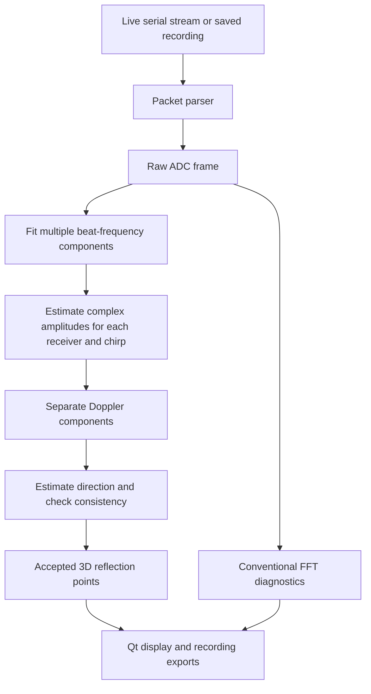

The current system takes raw samples from the radar, separates reflection components, estimates their directions, and draws the accepted results as a **sensor-relative point cloud**.

The new implementation improves the processing behind those points. It still has **not demonstrated a geometrically accurate reconstruction of a room**. The distinction matters: the code can produce plausible, repeatable reflection locations without establishing that those locations correctly describe walls or furniture.

Below is the implementation as it exists in the working tree.

**1. The overall data path**

The main path for `--point-cloud` is:



There are two processing branches inside the application:

- The **new point-cloud branch** works directly from the raw ADC samples.
- The **diagnostic branch** still calculates conventional range FFTs, range–Doppler information, and broad angular response maps.

That is why the side panels can show broad responses while the main plot shows only a few accepted points. They display different reductions of the same measurements.

The coordinating code is [radar/processing.py](/home/andrea/Documents/F26/sd/radar-demo/radar/processing.py:117).

**2. What the radar actually supplies**

The Python application receives real ADC measurements from three receivers. The serial payload is not already a point cloud, and it is not a stream of complex I/Q values.

For the qualification configuration used by the door recordings, each frame contains:

| Item                            |       Value |
| ------------------------------- | ----------: |
| Receivers                       |           3 |
| Stored chirps                   |          17 |
| Samples per chirp per receiver  |          64 |
| Raw ADC values per frame        |       3,264 |
| Transport storage per ADC value |     16 bits |
| Nominal frame interval          | 0.1 seconds |
| Nominal ADC sample rate         |       5 MHz |
| Nominal carrier frequency       |      60 GHz |

The host arranges the decoded values as:

```text
adc[chirp, sample, receiver]

shape = (17, 64, 3)
```

The values are transported as unsigned 16-bit integers. That describes the container format; it does not establish the effective ADC resolution or prove that the analog signal uses all 16 bits.

There are three distinct measurement dimensions:

- **Fast time:** the 64 samples inside a chirp. Their oscillation frequencies provide range information.
- **Slow time:** the sequence of chirps. Phase changes between chirps provide Doppler information.
- **Receiver position:** the three antennas observe different phases. Those differences provide directional information.

The complex amplitudes used later are calculated from these real samples.

**3. What the firmware does**

The firmware initializes the board, SPI interface, radar configuration, timer, and serial interface. It waits for a host command before streaming.

The relevant commands are:

- `B`, byte `0x42`: enable acquisition.
- `c`, byte `0x63`: disable acquisition.

For each capture, the firmware resets the radar acquisition state machine and FIFO, clears relevant interrupt/error flags, triggers the radar sequence, drains the FIFO, and collects enough data for:

```text
17 chirps × 64 samples × 3 receivers
```

It then stops the capture and packages the data for transmission.

The firmware uses two packet buffers so acquisition and asynchronous serial transmission can alternate between buffers. If the previous transmission is still active when another scheduled capture is due, it increments the drop count.

The qualification firmware also selects and checks the requested analog high-pass setting. The profile IDs distinguish the supported qualification profiles:

| Profile               | ID             |
| --------------------- | -------------- |
| 100 kHz qualification | `0x33514801` |
| 350 kHz qualification | `0x33514802` |

The qualification packets include elapsed acquisition-path time. That value is **not a measurement of the spacing between individual chirps**.

The source is [experiments/qualification/main.c](/home/andrea/Documents/F26/sd/radar-demo/experiments/qualification/main.c). The new point-cloud processing does not require a firmware modification.

One important assumption remains: the stored chirps must correspond to compatible radar ramps with suitable timing. The bounded raw capture and a matching profile ID do not independently prove every physical timing parameter.

**4. How the serial packets are decoded**

Packets use the `GRD3` format, implemented in [radar/protocol.py](/home/andrea/Documents/F26/sd/radar-demo/radar/protocol.py:35).

Each packet contains:

- A magic marker.
- Protocol version and header length.
- Payload size.
- Frame sequence number.
- Device timestamp.
- Acquisition profile ID.
- Chirp, sample, and receiver dimensions.
- Flags.
- Device drop and error counters.
- Optional acquisition elapsed-time information.
- Header CRC.
- ADC payload.
- Whole-packet CRC.

The parser maintains a byte buffer because a serial read does not necessarily correspond to one complete packet. A read can contain part of a packet, one packet, or several packets.

The parser searches for `GRD3`, validates the header, waits for a complete payload, and checks the packet CRC. If it finds invalid bytes, it resynchronizes and records counters for corruption or discarded data.

It also checks sequence numbers to count gaps and detect restarts or duplicates.

A successful CRC establishes that the stored bytes are internally consistent. It does not establish physical calibration, correct antenna orientation, or target identity.

**5. How live, replay, and synthetic inputs are unified**

[radar/acquisition.py](/home/andrea/Documents/F26/sd/radar-demo/radar/acquisition.py:8) provides the `Source` class.

It supports three sources:

- **Live:** reads the board through PySerial at 2,000,000 baud.
- **Replay:** reads packets from a saved `frames.grd` file.
- **Synthetic:** generates ADC frames from simulated targets.

All three produce the same `Frame` object, so the processing code receives the same kind of input regardless of where it came from.

Replay in the GUI is paced using the configured frame interval. Headless processing runs through the saved frames without that display pacing.

When a live source closes, it sends the stop command and closes the serial port.

**6. What the configuration controls**

The configuration is the host’s description of how to interpret the samples. Loading it does not program the radar.

[radar/config.py](/home/andrea/Documents/F26/sd/radar-demo/radar/config.py:11) contains:

- Acquisition dimensions and profile ID.
- Sample rate and chirp slope.
- Carrier frequency and chirp interval.
- Number of initial chirps to discard.
- Antenna coordinates.
- Mounting rotation.
- Complex receiver gain corrections.
- A complex array correction matrix.
- Range scale and offset.
- Verification flags.

The current nominal physical receiver coordinates are:

```text
RX1: ( 0.00, 0.00) mm
RX2: ( 0.00, 2.35) mm
RX3: (-2.35, 0.00) mm
```

These are right/up coordinates in the defined antenna-face reference.

The code converts millimetres into wavelengths using the configured carrier frequency. `mount_roll_deg` rotates that array model around the forward axis.

A correct mounting rotation is necessary to interpret horizontal and vertical directions. Rotating the model cannot remove unknown receiver phase offsets or separate mixed reflections.

The qualification configuration includes a nominal correction matrix, but its presence does not establish that the complete angular model has been validated for the current board, mounting, and environment.

The configuration loader used by the point-cloud mode also accepts older `radar_min` acquisition files. Those files lack full spatial calibration, so the loader supplies an explicitly unverified physical array assumption.

**7. What changed in the new point-cloud method**

The old method approximately does:

```text
Range FFT
→ Doppler FFT
→ select local peaks
→ estimate one direction for each selected peak
```

The new method does:

```text
Fit overlapping beat-frequency components directly to the real ADC
→ recover their complex receiver amplitudes
→ separate Doppler
→ estimate direction
→ reject inconsistent components
```

The main new implementation is [radar/reconstruction.py](/home/andrea/Documents/F26/sd/radar-demo/radar/reconstruction.py:75).

The reason for making this change is that an FFT peak can contain contributions from several nearby reflections. Estimating direction from that mixture can give a direction that describes none of the individual reflectors.

The new method attempts to separate those contributions before estimating direction.

This is a staged estimator: range frequencies are fitted jointly across the traces, followed by direction estimation. It is not a joint optimization of room surfaces, sensor trajectory, and material properties.

**8. Preprocessing the raw frame**

The reconstruction first checks:

- The ADC array has the configured dimensions.
- Values are finite.
- Values do not touch the unsigned container rails.

It discards the configured startup chirps. With the current setting, the first chirp is discarded, leaving:

```text
16 chirps × 3 receivers = 48 traces

Each trace has 64 fast-time samples.
```

Each trace is converted to floating point and has its sample mean removed.

This removes a constant fast-time offset. It does not remove stationary room reflections: those reflections still create oscillating beat signals within each chirp.

Unlike the conventional FFT branch, the raw fitting branch does not apply a Hann window to the fast-time samples.

Every frame is reconstructed independently. The algorithm does not carry previous points forward to fill a missing result.

**9. The signal model used for deblending**

The implementation assumes that each trace can be approximated as a sum of sinusoids:

\[
x_t[n]
======

d_t+
\sum_{k=1}^{K}
\left[
a_{t,k}\cos\left(2\pi\nu_k n/N\right)
+
b_{t,k}\sin\left(2\pi\nu_k n/N\right)
\right].
\]

Here:

- \(t\) identifies a chirp/receiver trace.
- \(n\) is the sample index.
- \(N=64\).
- \(K\) is the number of fitted beat-frequency components.
- \(\nu_k\) is a frequency in native FFT-bin units.
- \(a_{t,k}\), \(b_{t,k}\), and \(d_t\) are fitted separately for each trace.

The frequencies are shared across all 48 traces. Amplitude and phase can vary between receivers and chirps.

For example, a fitted frequency can be `3.2` rather than being restricted to integer FFT bin `3`.

That provides an off-grid estimate under the sinusoidal model. It does not add transmitted bandwidth or guarantee that arbitrary close reflectors can be separated.

**10. How candidate frequencies are found**

The code builds a Hankel matrix from overlapping portions of the fast-time traces.

With 64 samples, it uses windows of length 32. Each trace contributes 33 overlapping windows. Combining 48 traces produces a matrix with shape:

```text
32 × 1,584
```

It calculates a covariance-like matrix:

\[
R=\frac{HH^T}{\text{number of columns}}.
\]

Then it performs an eigendecomposition.

A sinusoid has a predictable relationship between samples shifted by one position. The code uses that shift relationship in selected eigenvector subspaces to estimate complex poles. This is an ESPRIT-style frequency estimator.

The pole angle gives the candidate frequency:

\[
\nu = \frac{N}{2\pi}\arg(p).
\]

Because the ADC data are real, positive and negative frequency components appear as conjugate pairs. The code keeps the positive-frequency candidates.

It also applies numerical guards:

- Pole magnitude must be between `0.85` and `1.15`.
- Frequency must be between `0.5` and `N/2 − 0.5` native bins.
- The resulting sinusoidal fit must not be excessively ill-conditioned.

These are engineering guards for the model. They are not calibrated physical detection probabilities.

**11. How the number of components is chosen**

The default considers nominal model orders from one through eight.

For each model, it fits all traces and calculates a Bayesian Information Criterion-style score:

\[
\mathrm
=======

M\log(\mathrm{MSE})+P\log(M),
\]

where:

- \(M\) is the number of fitted sample values.
- `MSE` is the mean squared residual.
- \(P\) counts the fitted parameters.

The parameter count includes the shared frequencies and the per-trace sine, cosine, and DC coefficients.

This balances two tendencies:

- Additional components can explain more of the waveform.
- Additional components can also fit noise or modeling errors.

The lowest-scoring model is selected.

The code then ranks its components by fitted power and prevents components closer than `0.35` native bins from both surviving.

At the current nominal bin spacing, `0.35` bins is approximately 12 cm. That is a numerical separation rule, **not demonstrated 12 cm physical resolution**.

The default limit is eight beat-frequency components. It is not necessarily eight points, because a frequency component can subsequently contain multiple Doppler peaks.

BIC is being used heuristically. Colored noise, filter transients, and correlated traces can violate the assumptions behind its statistical interpretation.

**12. How the frequencies are refined**

The initial pole-derived frequencies are refined by an off-grid least-squares procedure in [refine_frequencies](/home/andrea/Documents/F26/sd/radar-demo/radar/reconstruction.py:42).

For fixed frequencies, the sine/cosine coefficients are linear parameters. The code solves those parameters with least squares, then adjusts the frequencies to reduce the remaining error.

It uses a variable-projection Gauss–Newton approximation:

1. Fit the linear coefficients.
2. Calculate derivatives with respect to the frequencies.
3. Remove derivative directions already explained by the linear fit.
4. Solve for a frequency update.
5. Try progressively smaller updates.
6. Accept an update only if it reduces residual error.

The implementation allows at most eight refinement iterations. An update is capped at `0.2` native bins, and the line search tries scale factors of `1`, `0.5`, `0.25`, and `0.125`.

The frequencies remain inside the allowed interval and maintain the configured minimum separation.

The numerical stopping tolerance is a solver tolerance. It is not a physical accuracy claim.

**13. Recovering complex amplitudes**

After refinement, the final fit gives sine and cosine coefficients for every component, receiver, and chirp.

The code combines them as:

\[
A_{t,k}=a_{t,k}-j b_{t,k}.
\]

That produces complex amplitudes even though the original ADC measurements were real.

The amplitudes are reshaped into:

```text
[chirp, frequency component, receiver]
```

The configured complex receiver gains are then applied.

This array contains the phase relationships needed for both Doppler and direction estimation. Crucially, those relationships now belong to fitted frequency components rather than a potentially blended FFT bin.

**14. Separating Doppler components**

For each fitted frequency, the algorithm applies a Hann window across the chirps and takes a Doppler FFT.

With 16 retained chirps, there are 16 Doppler bins.

Zero Doppler is retained, so stationary walls and objects can remain in the output.

The algorithm selects local maxima along the Doppler axis. This allows two returns at the same fitted range frequency to produce different points when their Doppler components are separable.

The cloud stores Doppler in **cycles per chirp**. The hardware configuration does not currently verify chirp timing and carrier frequency sufficiently to advertise these cloud values as measured metres per second.

Doppler separation does not solve the case where multiple coherent reflectors share both range and Doppler.

**15. Estimating signal strength relative to fitting error**

The code estimates residual variance from the sinusoidal least-squares fit.

It propagates that estimate through the fitted design matrix to approximate the noise in the complex coefficients, then accounts for the Doppler window.

The resulting component power-to-estimated-noise ratio is expressed in dB.

The default threshold is **8 dB**.

This is a model-based screening statistic. The residual can contain:

- Noise.
- Unmodeled reflections.
- Filter effects.
- Frequency estimation errors.
- Departures from the sinusoidal model.

Consequently, it is not a calibrated thermal-noise measurement, CFAR false-alarm guarantee, or obstacle probability.

**16. Estimating direction from the three receivers**

Direction fitting uses the steering model constructed by [SpatialMapper](/home/andrea/Documents/F26/sd/radar-demo/radar/spatial.py:16).

The search grid covers:

```text
Azimuth:   −60° to +60°
Elevation: −60° to +60°
Grid step: 5°
```

For each tested direction, the code predicts the relative complex receiver response from the antenna coordinates.

It incorporates the configured array correction matrix by solving for the expected response in the raw receiver domain. The signatures are normalized before comparison.

For an observed three-receiver vector \(v\), it evaluates:

\[
\mathrm{response}(\theta,\phi)=|w(\theta,\phi)^H v|^2.
\]

The strongest response supplies the estimated direction.

The model-fit score is:

\[
\mathrm
=======

\frac{\max_{\theta,\phi}|w(\theta,\phi)^H v|^2}{v^H v}.
\]

The default minimum is **0.65**.

This measures compatibility with the assumed array response. It does not establish that the selected direction belongs to a particular physical object.

The 5° grid is search spacing. It is not a measured 5° angular resolution or accuracy specification.

**17. Checking whether a component is stable**

The reconstruction refits the component coefficients using two sample subsets:

- Samples `0–47`.
- Samples `16–63`.

Those subsets overlap by 32 samples.

For each subset, the code recalculates the complex amplitudes, Doppler components, and estimated directions.

A candidate is rejected if:

| Check                   | Rejection condition                                                         |
| ----------------------- | --------------------------------------------------------------------------- |
| Search boundary         | Best direction lies on an outer angular-grid boundary                       |
| Array compatibility     | Model-fit score is below `0.65`                                           |
| Direction sensitivity   | Subset direction differs from the full-data direction by more than `15°` |
| Coefficient sensitivity | Relative complex-coefficient difference exceeds `0.5`                     |

The frequency estimates came from the full frame and are reused in these subset fits. Therefore, this is **an aperture-sensitivity check**, not independent validation of the frequencies.

The code also records how well a subset fit predicts the remaining samples. That whole-waveform prediction error is currently diagnostic; it is not a universal rejection gate.

Likewise, the overall residual fraction and the model-order-limit flag are recorded but are not calibrated confidence values.

**18. Creating the actual XYZ points**

An accepted direction is converted to a unit vector:

\[
u=
\begin{bmatrix}
\sin(\mathrm{az})\cos(\mathrm{el})\\
\cos(\mathrm{az})\cos(\mathrm{el})\\
\sin(\mathrm{el})
\end{bmatrix}.
\]

Its range is calculated from the fitted frequency:

\[
r=\nu\,\Delta r+\mathrm{range\_offset},
\]

where \(\Delta r\) includes the configured sample rate, chirp slope, sample count, and range scale.

The point is:

\[
\mathrm{XYZ}=r\,u.
\]

The coordinate system is:

- **X:** right.
- **Y:** forward.
- **Z:** up.

The origin is the radar coordinate origin. The output has no room-relative or world-relative pose.

Each point contains these fields:

| Field                        | Meaning                                          |
| ---------------------------- | ------------------------------------------------ |
| `xyz`                      | Estimated sensor-relative position               |
| `range_bins`               | Rounded native-bin index for compatibility       |
| `doppler_cycles_per_chirp` | Normalized Doppler location                      |
| `snr_db`                   | Model-based signal/error statistic               |
| `model_fit`                | Compatibility with the array signature           |
| `angular_width_deg`        | Span of the half-power angular response          |
| `power_db`                 | Matched-response energy on the ADC-derived scale |

The precise fractional frequency is retained in the detailed reconstruction report. It should not be recovered from the rounded `range_bins` field.

`angular_width_deg` describes the response shape. It is not a confidence interval or the physical size of an object.

**19. What happens to rejected candidates**

Candidates that reach the directional checks but fail them are retained in the detailed report with rejection reasons.

They do not receive an accepted XYZ point.

That prevents a direction clipped to the field-of-view boundary, or one that changes substantially with the sample subset, from silently becoming an apparently precise spatial observation.

The displayed unresolved count refers to candidates reaching these checks. It does not count every possible missed reflection or every component rejected earlier by signal-strength screening.

An empty cloud means the current processing did not produce an accepted 3D hypothesis. It does not establish that the sensed space is empty.

**20. What the GUI does**

The GUI is implemented in [radar/gui.py](/home/andrea/Documents/F26/sd/radar-demo/radar/gui.py:31), using PyQt6 and Matplotlib.

In point-cloud mode it now opens the spatial view directly instead of starting on the distance-monitor tab.

The display contains:

- A larger main 3D plot.
- A sensor-origin marker.
- Azimuth/range diagnostics.
- Elevation/range diagnostics.
- An angular-response slice.
- Counts for accepted returns and unresolved components.

The main plot draws accepted point locations. The side panels still show the conventional FFT-based response volume.

The default visible range is 4 m. Changing that control changes rendering, not the reconstruction’s candidate search. As a result, the total processed-point count can exceed the number currently visible in the plot.

The renderer caches artists and uses blitting where possible, updating existing images and point coordinates rather than rebuilding the entire figure on every refresh.

The new raw deblending mode disables empty-scene capture. It is intended to retain stationary scene reflections, and its input is the original ADC waveform. The existing spectral-background representation belongs to the FFT processing path.

**21. How acquisition and display run concurrently**

Acquisition and DSP run in a worker thread. Qt rendering runs in the main GUI thread.

The worker:

1. Reads a frame.
2. Processes it.
3. Writes recording output, when enabled.
4. Places the result in a display queue.

The display queue holds at most two results. If rendering falls behind, the worker discards an older display result and queues the newer one.

The Qt refresh timer runs every 50 ms and drains the queue to the newest available result.

This separates display throughput from recording throughput. A skipped display update does not itself mean a radar packet was lost.

There are integration limitations worth stating explicitly. The ordinary GUI acquisition path does not provide the same strict timing checks as the offline audit tools. It also does not proactively clear the last rendered cloud merely because fresh serial frames stop arriving. The reconstruction itself does not hold old points, but the last drawn image can remain visible during a stream stall.

**22. What gets recorded and exported**

[radar/storage.py](/home/andrea/Documents/F26/sd/radar-demo/radar/storage.py:8) manages recording folders.

Depending on the mode, a folder contains:

| File                 | Contents                                  |
| -------------------- | ----------------------------------------- |
| `config.json`      | Interpretation configuration              |
| `metadata.json`    | Session metadata and processing mode      |
| `frames.grd`       | Decoded frames saved in the packet format |
| `arrivals.jsonl`   | Host arrival information                  |
| `features.jsonl`   | Derived features and processing summaries |
| `pointcloud.jsonl` | Per-frame point arrays                    |
| `serial-wire.bin`  | Original serial chunks                    |
| `transport.jsonl`  | Chunk timing and parser counters          |

Original serial chunks are recorded through the acquisition source before per-frame DSP. In the GUI, decoded frames are written after processing succeeds. Thus, if DSP raises an exception, the original wire log can contain data that did not receive a corresponding processed-frame entry.

For detailed headless reconstruction, `radar.pointcloud` additionally exports per-frame reconstruction reports containing model orders, frequencies, residuals, component checks, and rejection reasons.

The headless command checks frame compatibility, continuity, rails, and final parser integrity. The larger evaluation tool also checks arrival sequences and relative host/device timing.

These are different levels of checking; the implementation should not be described as providing identical integrity guarantees in every mode.

**23. How the old FFT method differs**

The old implementation remains in [CloudProcessor](/home/andrea/Documents/F26/sd/radar-demo/radar/pointcloud.py:19).

It:

1. Removes fast-time means.
2. Applies a fast-time Hann window.
3. Calculates a range FFT.
4. Applies a chirp Hann window and Doppler FFT.
5. Calculates power over range and Doppler.
6. Applies a local range-noise estimate.
7. Finds local range/Doppler maxima.
8. Estimates one direction per selected peak.

It excludes native range bins zero and one, and Nyquist. It uses an 8 dB contrast threshold and a 0.65 array-fit threshold.

Range is interpolated from neighboring FFT powers.

It is simpler and remains useful for comparison, but nearby reflections can be blended before direction estimation.

Select it with:

```bash
--cloud-method fft
```

The new default is:

```bash
--cloud-method deblend
```

The deblending path can search fractional frequencies below native bin two, although that does not remove the analog limitations on close-range returns.

**24. What the broad volume renderer represents**

`--spatial-map` evaluates beam response over a grid of ranges and directions.

For each range bin, it forms a three-receiver covariance and evaluates a matched response across the angular grid.

Its many colored cells are **correlated direction hypotheses derived from the same few receiver observations**. They are not independently measured occupied voxels.

That is why the volume can show large lobes or shells. Rendering those cells densely does not establish walls, floors, or furniture surfaces.

The new point-cloud processor changes how reflection components are estimated. It does not turn the response volume into an occupancy model.

**25. How the other existing modes relate**

The repository also contains several separate experimental paths.

The `--obstacle-cloud` mode uses per-receiver spectral peaks, approximately one-second windows, and persistence over three windows. It can retain unresolved-range warnings separately from provisional XYZ candidates. It is not the new raw deblending processor.

The fixed-scene obstacle detector compares current profiles with calibrated open/closed scene templates. It recognizes a scene pattern; it does not reconstruct a room or identify glass material.

The short-range distance monitor uses an empty-scene comparison and a selected range-bin tracker. That tracking state is separate from the point cloud.

The material classifier uses XGBoost on waveform or spectral features. Its output does not gate the new point cloud and does not assign material to its points.

None of those branches supplies sensor motion or world coordinates to the new reconstruction.

**26. What is implemented concerning calibration**

The configuration supports:

- Complex per-receiver corrections.
- A complex array correction matrix.
- Physical antenna coordinates.
- Mounting rotation.
- Affine range scale and offset.

The channel-calibration helper can estimate relative receiver corrections from a known isolated target. It checks coherence and local signal isolation before accepting a reference.

That does not independently establish the complete array geometry or validate angular accuracy across the field of view.

The range-calibration helper fits an affine relationship between measured and surveyed distances using separated reference ranges. It is a separate operation from fitting reflection components.

The new reconstruction does not automatically calibrate itself from the room or adjust offsets until the picture looks plausible.

**27. What the completed evaluation currently shows**

The full new-method replay has now completed on **96 recordings and 18,807 frames**.

It produced:

| Measurement                             | Old method | New method |
| --------------------------------------- | ---------: | ---------: |
| Total accepted points across all frames |     42,437 |     13,129 |

The new method produced at least one accepted point in 85 recordings and no accepted points in 11.

Fewer points do not prove better geometry. The stricter checks reject many candidates, but their correctness still needs physical validation.

For the first closed recording in each door setup:

| Recording | Old median points/frame | New median points/frame |
| --------- | ----------------------: | ----------------------: |
| door03    |                       1 |                       2 |
| door04    |                       2 |                       3 |
| door07    |                       3 |                       1 |

For `door03/closed-01`, the old cloud had no points within 10 cm of the surveyed pane range. The new cloud has a point in that range neighborhood in all 303 frames.

That is useful development evidence. It does not independently establish that the point belongs to the pane or that its angle is correct.

Door04 still does not produce a point near its measured pane range in that recording.

The complete results are in [the reconstruction replay report](/home/andrea/Documents/F26/sd/radar-demo/artifacts/reconstruction-20261111/report.json).

**28. What testing establishes**

The new tests cover:

- Two nearby synthetic reflectors that the FFT cloud merges.
- Several stationary reflections.
- Opposite Doppler components at the same range.
- Noise and constant-input rejection.
- Withdrawing points when the next frame has no supported return.
- Rejecting directions at the angular search boundary.
- Complex gain and nonunitary matrix handling.
- Preserving the raw ADC during processing and recording.
- Invalid input rejection.

The focused set passed 29 tests.

The full suite ran **168 tests: 165 passed, one skipped, and two errored**. Both errors come from the missing external Infineon register-header dependency already identified earlier.

These tests establish numerical behavior and integration properties. They do not establish real-room geometry or transfer the synthetic accuracy to hardware.

The replay’s per-recording median reconstruction times were generally around 7–12 ms on this host under the evaluation settings. The worst recorded per-recording p95 was approximately 26 ms. GUI rendering, USB freshness, and end-to-end latency are separate measurements.

**29. What the implementation still does not provide**

The current code has no:

- Sensor-pose estimator.
- SLAM.
- SAR.
- World-coordinate accumulation.
- Wall or furniture segmentation.
- Surface meshing.
- Occupancy inference.
- Reliable glass identity assignment.

It also cannot uniquely separate arbitrary coherent reflectors that share the same range and Doppler using these three channels.

Moving the radar changes its coordinate frame. The program currently draws each frame relative to the sensor; it does not know how to align those frames into a room map.

The sparse sinusoidal model can also be wrong. Filter transients, multipath, extended surfaces, and changing returns can all produce misleading fitted components.

Those are the principal reasons that passing numerical checks and producing stable points have not yet translated into a demonstrated volumetric reconstruction.

**30. How to run the implemented paths**

Replay the new cloud:

```bash
.venv/bin/python -m radar gui \
  --replay recordings/door03/closed-01 \
  --point-cloud
```

Compare the old method:

```bash
.venv/bin/python -m radar gui \
  --replay recordings/door03/closed-01 \
  --point-cloud \
  --cloud-method fft
```

Run live with a matching 350 kHz qualification profile:

```bash
.venv/bin/python -m radar gui \
  --port YOUR_PORT \
  --config configs/qualification-hpf350.json \
  --point-cloud
```

Record that live session:

```bash
.venv/bin/python -m radar gui \
  --port YOUR_PORT \
  --config configs/qualification-hpf350.json \
  --point-cloud \
  --record recordings/room-cloud-01 \
  --start-delay 5 \
  --seconds 30
```

The recording directory must be new.

Export detailed reconstruction without the GUI:

```bash
.venv/bin/python -m radar.pointcloud \
  recordings/door03/closed-01 \
  --config recordings/door03/closed-01/config.json \
  --method deblend \
  --output artifacts/door03-cloud-export-01
```

The implemented improvement is **raw reflection deblending plus directional consistency checks**, connected to the live/replay interface and exports. Its demonstrated benefit is better separation in controlled synthetic cases and useful changes in some real recordings. Recognizable, physically validated room reconstruction remains unfinished.
