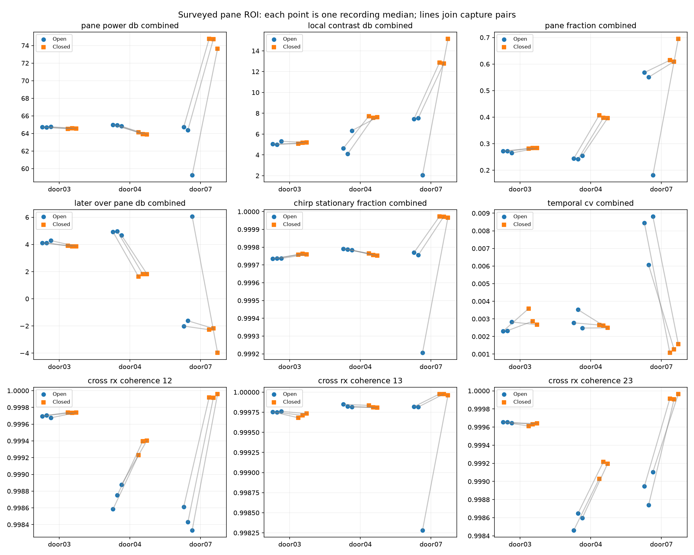
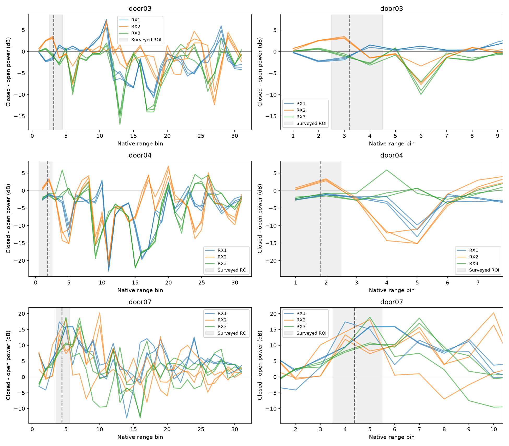

# Signal audit: repeatable door response, no isolated glass signature

The saved radar data contain repeatable door-state changes. They do **not** yet
demonstrate a signal specific to glass that transfers across setups. A small
RX1/RX2 coherence increase is consistent across all nine door-closure pairs,
but most of its paired change is reproduced by a stationary-scene surrogate
that uses no material identity. None of the 27 fixed measurements supports one
separating threshold across these recording medians.

This narrows the next experiment: isolate a standalone pane from its frame,
handling, background and generic obstruction effects before fitting another
classifier. The [capture protocol](../../docs/GLASS_SIGNATURE_CAPTURE.md) is ready
for hardware access. No new physical observations were collected in this audit.

## What was tested

The [initial protocol](PROTOCOL.md) was written before executing the new audit.
It fixes the range regions, processing and all 27 measurements. Raw captures
had already been inspected in earlier research; this is retrospective development
evidence, not a blind validation or an exhaustive search for possible signatures.

- 18 complete recordings: three open/closed pairs each in door03, door04,
  door07; **5,457 frames**, **522 ten-frame windows** after ten warm-up frames.
- Three setups represent **two physical doors**, following the retained prior
  research grouping. Repeats and windows are not independent material specimens.
- Door05/door06 remain explicitly excluded as incomplete.
- Every included recording passed config/profile/dimension, container-rail,
  CRC/framing/continuity, unchanged device-counter, arrival-sequence, duration
  and relative host/device timing checks. No identical ADC frame was shared
  across recordings. This does not establish RF calibration or absolute USB
  freshness.
- The corrected archived window/drywall study changed sensor view/background;
  wall distance is unknown. It is unsuitable for attributing paired changes
  to panel insertion. Later controls lack matched panel-absent scenes.

The surveyed pane distance supplies the diagnostic ROI in every setup, using
the recorded nominal RF scale: bins 3–4 for door03, 1–2 for door04, and 4–5 for
door07. This gives the audit known range information. It is not blind pane
localization, and physical pane-return ownership remains unresolved.

Each recording contributes one median for each metric. Six feature families
are measured separately on RX1, RX2, RX3 and combined power: pane power, local
contrast, pane energy fraction, later/pane energy ratio, chirp stationary
fraction and ten-frame temporal CV. Three cross-RX coherence measurements
complete the 27 metrics. Native FFTs preserve stationary energy; no calibration
fit, threshold search, classifier training or live integration occurred.

## What repeats and what changes by setup

Median paired changes below mean closed minus open. Effects come from the
recording summaries, not from counting correlated windows as accuracy trials.

| Setup | Combined pane power change (dB) | RX1/RX2 coherence change | Stationary-mean surrogate change |
|---|---:|---:|---:|
| door03 | -0.178 | +0.00004357 | +0.00003759 |
| door04 | -0.933 | +0.00064523 | +0.00061871 |
| door07 | +10.324 | +0.00148207 | +0.00147284 |

Combined pane power decreases in all door03/door04 pairs and increases in all
door07 pairs. Neither stronger reflection on closure nor a common absolute
power level describes all three setups. Receiver-specific changes can disagree
even within a setup. Door07 also has 5.47 dB of combined-power spread between
its open repeats; the saved observations do not identify its physical cause.

Eight of 27 metrics share a paired-change direction across all nine pairs.
Only **RX1/RX2 coherence** also passes the initial strict descriptive criterion
in every setup: every paired change exceeds the largest same-state repeat
change, with a common sign. The other receiver pairs do not show that pattern.
This is one observation from 27 measurements, not a significance claim.

Door03's margin is especially small: minimum paired coherence increase
0.00003094 versus maximum same-state change 0.00002860. Both states already
have coherence near one. Greater precision in the summary is not evidence of
physical material specificity or stability on a different day.

No measurement globally separates open/closed recording medians with one
direction and cutoff. For example, door04 closed RX1/RX2 coherence
(0.999231–0.999405) is below door03 open coherence (0.999676–0.999704), although
closure increases coherence within each setup. A scene-calibrated comparison
and an absolute material signature are different requirements.



## Why coherence is insufficient material evidence

The [follow-up protocol](COHERENCE_FOLLOWUP.md) was written **after** seeing the
initial coherence finding and before executing that follow-up. It is explicitly
post hoc and uses the same data. It evaluates every RX pair in the original pane
ROI, original reference bins, and remaining usable bins, without selecting a
new detector.

For each ten-frame window the surrogate replaces cross covariance with the
product of the receivers' complex stationary means, preserving total-power
normalization. This removes correlated temporal fluctuations. It corresponds
to independently pairing samples between receivers while preserving each
receiver's mean and power; no glass/material parameter is used.

The surrogate's median paired RX1/RX2 closure effects are approximately **86%,
96%, and 99%** as large as observed in door03, door04 and door07. These are ratios
of descriptive paired effects, not explained-variance estimates or confidence
levels. The small observed-minus-surrogate component has no common paired
direction across setups. Synthetic checks also show a generic stationary tone
plus independent noise producing near-unity coherence and a coherence increase
as tone strength rises, with no material labels.

This supports a stationary-scene mean/power explanation for much of the finding.
It does not prove a noise distribution, exclude a glass contribution, or identify
the actual scattering path. A fixed complex spectrum can belong to a pane, frame,
wall or other reflector. Larger background-bin changes also occur: RX1/RX2
coherence in the remaining usable bins changes by approximately -0.00945,
-0.00646 and +0.00364 across the three setups. Spectral regions are not isolated
physical objects, so these are context measurements, not certified negative
material controls.



## Decision and practical limits

The existing data justify retaining a **coherence hypothesis for controlled
attribution**, not deploying a glass score. Stronger stationary returns can
produce the same general coherence behavior, and fixed-scene door movement
does not isolate a material. The audit does not show that every radar method
must fail, nor does the absence of a univariate threshold rule out multivariate
methods. Earlier transfer-model failures remain separate evidence.

The next pilot holds the radar and fixture fixed, compares empty fixture,
glass, transparent non-glass and opaque panels, and repeats them with two
backgrounds. Its purpose is to distinguish panel effects from handling,
background and generic obstruction. A successful pilot would still require a
new physical pane and scene held out from feature/threshold selection.

## Reproduce and inspect

From the repository root, with the existing project environment:

```bash
MPLCONFIGDIR=/tmp/radar-signature-mpl .venv/bin/python -m tools.audit_glass_signature \
  recordings artifacts/glass-signature-new
.venv/bin/python -m tools.audit_coherence_origin \
  artifacts/glass-signature-new/report.json artifacts/glass-coherence-new
```

Both output directories must be fresh. No archive restoration, XGBoost, network,
board access or flashing is required. Window-level CSVs and plots are generated
in those directories. Retained full recording summaries, raw/config/manifest
hashes and all metric comparisons are in [report.json](report.json); all
follow-up summaries are in [coherence-origin.json](coherence-origin.json).

The [test log](tests.txt) records **37 passing focused tests**, including the
12 new signal/decomposition/statistical-comparison and raw-integrity tests,
plus existing material, door-capture and recording-audit tests. This is not a
fresh full-suite result. Synthetic checks validate the arithmetic and guard
against several false interpretations; they do not establish hardware accuracy.
