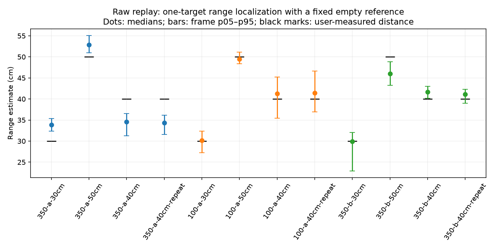

# What the saved raw measurements establish about spatial detail

The raw recordings already demonstrate **centimetre-scale single-target range
localization in some fixed scenes**. The 35 cm nominal range-bin spacing is not
a measured position error, and the approximately 70-degree modeled array response
is not a measured angular error. Neither should replace empirical results when
discussing how accurately this project locates a reflection.

There is still no measured room-map accuracy or general two-object resolution.
The available range labels, conditional point jitter, angular response width,
and actual geometric accuracy answer different questions.

## Existing range experiment reproduced from raw ADC

The unchanged `tools.replay_hpf_series` was rerun on all 18 recordings of the
350-a / 100-a / 350-b experiment. Its fixed empty reference uses only the first
30 empty-before frames in each run. It checks each target recording against
the retained original results. No distance label enters the fitter, no new
calibration is fitted, and every target frame is scored even if the separate
presence detector rejects it.

| Run | Target frames | Single-tone fit MAE | Absolute error p95 | Fine FFT peak MAE |
|---|---:|---:|---:|---:|
| 350-a | 404 | 4.60 cm | 7.59 cm | 5.95 cm |
| 100-a | 404 | 1.83 cm | 5.52 cm | 10.56 cm |
| 350-b | 404 | 2.26 cm | 6.24 cm | 6.86 cm |

The user-measured box positions are 30, 40 and 50 cm, with an untouched 40 cm
repeat. This is a **single-target, background-subtracted range fit**, not the
current point-cloud algorithm. It assumes one shared sinusoidal beat frequency
with independent per-chirp/RX amplitude, phase and DC. A low error under that
assumption does not establish separation of two simultaneous reflectors, correct
angular attribution or a usable map from a moving sensor. The 100 kHz run's
better result is not a universal filter-setting recommendation; the returned
350 kHz run improves substantially over the first 350 kHz run.

Errors are relative to user-reported placements, whose uncertainties are not
instrument-certified. A mean error is not a bound on each frame. These are
previously inspected development recordings. The same scene contains background
objects, and accepted presence decisions do not certify object ownership.



[range-summary.json](range-summary.json) retains the aggregate values. Full
per-recording results and 1,728 evaluated target/control frame records are under
`artifacts/resolution-hpf-replay-20261111/` (90 initial-empty training frames are
excluded from evaluation). Original evidence and physical setup limitations
remain in `HPF_COMPARISON_RESULTS.md` and `evidence/hpf-pair-2/`.

## Current point cloud

The separate empirical audit runs the actual `CloudProcessor` with unchanged
defaults, preserving every valid frame and all selected points. It checks raw
framing/CRC, continuity, unchanged device counters, container rails, configuration,
arrival sequence/count and relative timing. Invalid/empty raw inputs remain
explicit exclusions; incomplete door experiments contribute no raw frames. It does not change a
threshold, add a target ROI, subtract a scene, fit angles or accumulate a world map.

For each recording it reports point counts, strongest-point range, and the
most frequently detected range/Doppler cell. That cell is selected by frequency
of occurrence, without known target ranges. Its XYZ spread and missing-frame
fraction describe **conditional repeatability**, not ground-truth accuracy.
A wrong direction can be highly stable. The 5-degree angle-search grid can also
make small angular jitter appear exactly zero.

Known range labels from the retained recording inventory are used only after
point extraction. The count of frames with any point within 10 cm of a supplied
range is a diagnostic, not a target detection rate. Nearby points can belong
to other objects; an open-door range label identifies where the closed pane
would be. Archived minimal configs use an explicitly unverified portrait array
and neutral channel gains.

The current cloud excludes native bins 0 and 1 and uses a different estimator
from the short-range tone fit. The centimetre-scale box-fit numbers above must
not be advertised as the cloud's achieved accuracy.

The completed run processes **96 valid recordings / 18,807 frames / 42,437
points**, with eight empty raw files explicitly rejected. Door05/door06 are
incomplete manifests with no accepted-frame file to evaluate. In the 18 complete
door-state recordings, per-recording median point counts range from one to three.

| Setup | Closed frames with any cloud point within 10 cm of surveyed range | Open frames with any such point |
|---|---:|---:|
| door03 | 0 / 909 | 0 / 909 |
| door04 | 1 / 909 | 1 / 909 |
| door07 | 909 / 911 | 614 / 910 |

These are pane-neighborhood diagnostics, not material classifications or
certified detections of the pane. Open scenes contain real background objects.
For example, door04's most frequently detected range/Doppler cell in the first
closed recording has median range 84.1 cm and coordinate standard deviations
of about 0.08/0.22/0.02 cm. The surveyed pane distance is 63.5 cm. The return may
belong to another reflector: its tiny jitter cannot establish a correct pane
position or a 3D accuracy bound. No target label was used to select that cell.

The full [pointcloud-report.json](pointcloud-report.json) retains every recording,
input hashes, assumptions, missing-point fractions and conditional XYZ spreads.
Per-frame counts and strongest-point ranges are in
`artifacts/pointcloud-resolution-20261111/frames.csv`.

## What is missing from these recordings

The current raw inventory supplies measured ranges but no surveyed left/right/up
target coordinates, known simultaneous two-target separations or measured
sensor trajectories. Older documentation refers to plate, bottle and detkin
captures that are absent from this checkout's raw recording folders. Those
historical summaries cannot become newly verified angular truth.

Consequently, the data can support a raw range-error result and a point-output
stability audit. They cannot produce an honest numeric angular/XYZ error bound
or final moving-room-map resolution. That limitation is about missing ground
truth, not a claim that the hardware's angular error equals its beam width.

## Reproduce

Use fresh output directories from the repository root:

```bash
MPLCONFIGDIR=/tmp/radar-empirical-mpl .venv/bin/python -m tools.replay_hpf_series \
  artifacts/resolution-hpf-new
.venv/bin/python -m tools.audit_pointcloud_recordings \
  recordings artifacts/pointcloud-resolution-new
```

The four existing point-cloud tests and three new summary tests pass. The new
tests explicitly preserve missing frames and demonstrate that a stable point
does not imply geometric accuracy. No live acquisition or firmware was changed.
